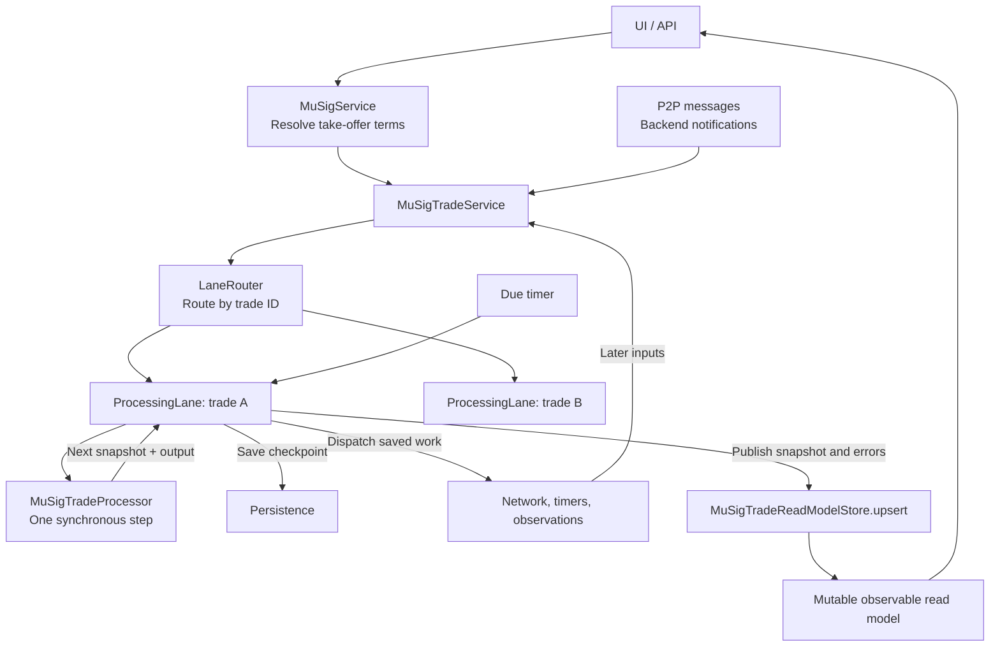
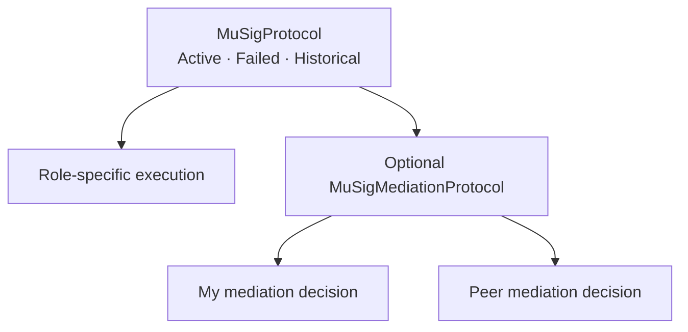
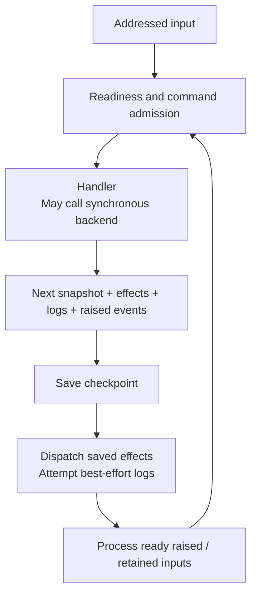

# MuSig V2 architecture

Start here for the V2 experiment. The application still uses MuSig V1; replacing it and connecting the V2 read
model to the desktop remain open work. This page explains structure. The linked documents own the details:

| Read next | Responsibility |
| --- | --- |
| [Decisions](decisions.md) | Why the current design was chosen; deliberate differences from V1 |
| [Processing rules](processing-rules.md) | Current admission, persistence, duplicate, failure, recovery and mediation rules |
| [Open work](todo.md) | Unresolved decisions and implementation work |
| [Risks](risks.md) | Current overload and memory risks, including proposals under discussion |
| [Threading walkthrough](processing-lane-threading.md) | What queues and workers do today |
| [Closure comparison](closure-comparison.md) | V1/V2 timeout and payout behavior, with pinned backend evidence |

Keep each rule in its owning document and link to it elsewhere. Temporary review notes are historical evidence,
not another specification of current behavior.

## Ownership and responsibilities

The Java package layout follows these responsibilities:

| Package under `bisq.trade.mu_sig_v2` | Contents |
| --- | --- |
| Root | Trade service, initialization command, admission, persistence, delivery adapters and observable read models. Service collaborators remain package-private. |
| `protocol` | Synchronous processor, contexts, shared handler contracts, parent trade snapshot/state/data and lifecycle rules. |
| `protocol.execution` | Execution snapshot/data, sealed state family, execution rules and role-specific handlers. Custom payout signing and finalization belong here because they change execution. |
| `protocol.mediation` | Mediation case and decision snapshots, states, rules and handlers. |
| `protocol.events` | Local event types, grouped by purpose. |

Keep each flow's state, data and rules together. Effect declarations belong with the flow that requests them;
the service's adapters execute those effects. Generic routing, lanes and state-machine mechanics remain in `common`.

One service manages many trades. Each trade ID has one processing lane. A lane serializes its work on a shared
worker pool; it does not have a dedicated thread. The processor and protocol definitions contain no threading
or locking code.

| Component | Responsibility |
| --- | --- |
| [MuSigService](../../../mu-sig/src/main/java/bisq/mu_sig_v2/MuSigService.java) | Validates participants, resolves mediator/arbitrator/price, calculates the attempt ID and creates `InitializeTrade`. |
| [MuSigTradeService](../../../trade/src/main/java/bisq/trade/mu_sig_v2/MuSigTradeService.java) | Public trade API, network listener, lifecycle, storage and adapter wiring; exposes read models and operation futures. |
| [MuSigSubmissionPolicy](../../../trade/src/main/java/bisq/trade/mu_sig_v2/MuSigSubmissionPolicy.java) | Checks restrictions on new submissions without accessing a live trade. |
| [MuSigTradeAdmission](../../../trade/src/main/java/bisq/trade/mu_sig_v2/MuSigTradeAdmission.java) | Application callbacks for creating taker/maker trades, including maker request validation. Runs on the lane worker. |
| [LaneRouter](../../../common/src/main/java/bisq/common/processing/LaneRouter.java) | Checks submission policy, constructs or restores lanes, buffers startup traffic, routes by ID and remembers final initialization rejections. |
| [ProcessingLane](../../../common/src/main/java/bisq/common/processing/ProcessingLane.java) | Serial queue, initialization/setup, live snapshot, pending work, checkpoints, effects, timers and publication. |
| [Processor](../../../common/src/main/java/bisq/common/processing/Processor.java) | Validates and routes inputs inside one entity; evaluates one addressed step. Simple entities can use it without a state machine. |
| [StateMachineProcessor](../../../common/src/main/java/bisq/common/statemachine/StateMachineProcessor.java) | Implements that interface using typed rule tables, flow hierarchy and per-flow processing history. |
| [MuSigTradeProcessor](../../../trade/src/main/java/bisq/trade/mu_sig_v2/protocol/MuSigTradeProcessor.java) | Binds MuSig flow definitions, snapshot writers, validation and failure classification. |
| [MuSigTradeEffectHandler](../../../trade/src/main/java/bisq/trade/mu_sig_v2/MuSigTradeEffectHandler.java) | Executes saved application effects through chat, network, offer and backend-observation adapters. |
| [MuSigTradeReadModelStore](../../../trade/src/main/java/bisq/trade/mu_sig_v2/MuSigTradeReadModelStore.java) | Creates and announces each read model once; `upsert` updates the same instance. |

`common.processing` owns the generic lane contracts; `common.statemachine` depends on them. The lane has no MuSig
business rules. Application callbacks define admission, setup, persistence and delivery. A simple counter uses
that same boundary in [ProcessingLaneTest](../../../common/src/test/java/bisq/common/processing/ProcessingLaneTest.java).

## Flow hierarchy

Execution and mediation can progress independently under an active parent. A failed parent stops its descendants;
a failed child stops only itself. Execution failure raises a saved event that moves the parent to `Failed` in a
separate step. Mediation failure leaves execution running. This is processing hierarchy, not a complete SCXML
implementation with general entry/exit semantics.

## State, data and persisted work

| Flow | Snapshot and business data |
| --- | --- |
| Parent | [MuSigV2Trade](../../../trade/src/main/java/bisq/trade/mu_sig_v2/protocol/MuSigV2Trade.java): ID, `MuSigTradeState`, [MuSigV2TradeData](../../../trade/src/main/java/bisq/trade/mu_sig_v2/protocol/MuSigV2TradeData.java), execution and optional mediation |
| Execution | [MuSigV2TradeExecution](../../../trade/src/main/java/bisq/trade/mu_sig_v2/protocol/execution/MuSigV2TradeExecution.java): state and [MuSigV2TradeExecutionData](../../../trade/src/main/java/bisq/trade/mu_sig_v2/protocol/execution/MuSigV2TradeExecutionData.java) with accumulated signatures, transactions and artifacts |
| Mediation | [MuSigV2Mediation](../../../trade/src/main/java/bisq/trade/mu_sig_v2/protocol/mediation/MuSigV2Mediation.java): case state, [MuSigV2MediationData](../../../trade/src/main/java/bisq/trade/mu_sig_v2/protocol/mediation/MuSigV2MediationData.java) and both decision snapshots |
| Each decision | [MuSigV2MediationDecision](../../../trade/src/main/java/bisq/trade/mu_sig_v2/protocol/mediation/MuSigV2MediationDecision.java): decision state and [MuSigV2MediationDecisionData](../../../trade/src/main/java/bisq/trade/mu_sig_v2/protocol/mediation/MuSigV2MediationDecisionData.java) |

Each snapshot implements `FlowSnapshot.state()/data()`. Children sit beside parent data. Concrete writers preserve
all children when applying a parent transition; a child writer changes only that child. This guarantee belongs
to the MuSig bindings, not generic inspection of arbitrary documents.

`StateMachineSnapshot` adds per-flow successful-input history. [MuSigV2TradeRecord](../../../trade/src/main/java/bisq/trade/mu_sig_v2/MuSigV2TradeRecord.java) persists
that snapshot with pending addressed inputs, effects and absolute timer deadlines. Lanes, handlers, callbacks,
futures and read models are reconstructed, not serialized. See the [serialization rules](processing-rules.md#serialization).

[MuSigProtocolContext](../../../trade/src/main/java/bisq/trade/mu_sig_v2/protocol/MuSigProtocolContext.java) provides current read-only sibling views plus services and clock
to handlers. Admission sees only [MuSigReadOnlyContext](../../../trade/src/main/java/bisq/trade/mu_sig_v2/protocol/MuSigReadOnlyContext.java). Both views expose state and data;
neither permits sibling writes. Deferred work gets fresh views when reconsidered.

## One processing step

Every applied flow transition is saved before another flow reacts. These are separate saved steps, not one
all-or-nothing transaction. Synchronous backend calls happen inside handlers, before that save. They occupy a
worker; waiting for a later message does not. Handlers and future continuations must not wait for work queued
on the same lane or shared pool. A backend call and a disk write are not atomic.

An unavailable command is rejected when its turn arrives. Relevant messages can wait without blocking another
message that advances the state. Raised events stay inside the lane and take priority over the next external
input. Precise ordering and failure behavior belong in [processing rules](processing-rules.md).

## Queues and recovery

| Location | Purpose and durability |
| --- | --- |
| Router startup buffer | Holds inputs until recovery has been queued for all restored owners; memory only. |
| Lane inbound queue | Serializes submissions and timer callbacks; memory only. |
| Same lane's pre-initialization stash | Holds configured early messages until admission succeeds; memory only. |
| Pending addressed inputs | Saves relevant messages and raised events waiting for a step or state, once their checkpoint succeeds. |

Initialization saves the trade and first protocol input, runs idempotent chat setup, then processes that input
before replaying waiting messages. Startup restores all owners first, queues each one's recovery, then releases
incoming traffic. Each lane waits for its own recovery; routing does not wait for every trade to finish recovery.

## Read model and API results

[MuSigTradeReadModel](../../../trade/src/main/java/bisq/trade/mu_sig_v2/MuSigTradeReadModel.java) is mutable, observable and memory-only. The store owns its mapping
and updates; callers cannot mutate the trade document through it. Startup rebuilds it from saved state.

Publication shows current local state, including an unsaved transition with a persistence error. It is not a
receipt for disk persistence or peer delivery. UI observation uses existing Bisq observables and `FxBindings`;
observers must not block waiting for the same lane. Separate observable properties are not an atomic document read.

Operation futures report one submission; the read model reports ongoing state. An exceptional future can accompany
an applied transition with pending coordination. See [results and publication](processing-rules.md#results-and-publication).
