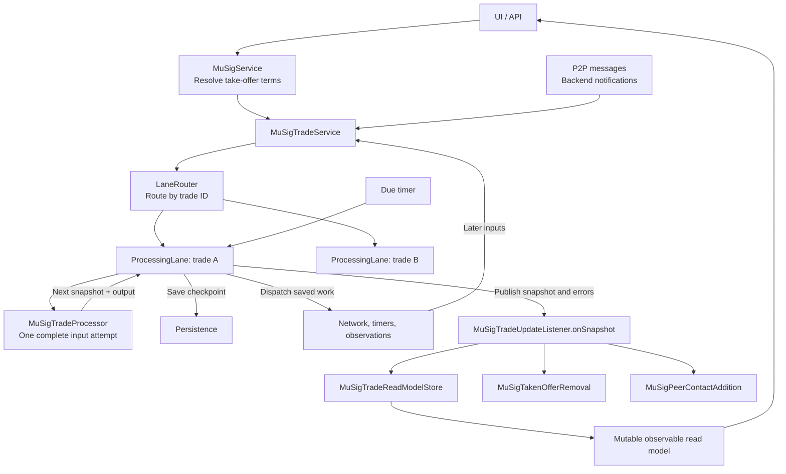
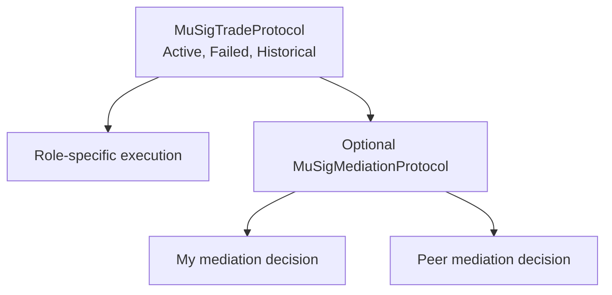

# MuSig V2 architecture

Start here for the V2 experiment. The application still uses MuSig V1; replacing it and connecting the V2 read
model to the desktop remain open work. This page explains structure. The linked documents own the details:

| Read next | Responsibility |
| --- | --- |
| [Decisions](decisions.md) | Why the current design was chosen; deliberate differences from V1 |
| [Input processing specification](../../specifications/trade/mu-sig-v2/input-processing.md) | Required behavior of input processing, failure and retry, and startup |
| [Open work](todo.md) | Unresolved decisions and implementation work |

Keep each rule in its owning document and link to it elsewhere.

## Ownership and responsibilities

The Java package layout follows these responsibilities:

| Package under `bisq.trade.mu_sig_v2` | Contents |
| --- | --- |
| Root | Trade service, initialization command, admission, persistence, delivery adapters and observable read models. Service collaborators remain package-private. |
| `protocol` | Synchronous processor, contexts, shared handler contracts, parent trade snapshot/state/data and lifecycle rules. |
| `protocol.execution` | Execution snapshot/data, sealed state family, execution rules and role-specific handlers. Custom payout signing and finalization belong here because they change execution. |
| `protocol.mediation` | Mediation case and decision snapshots, states, rules and handlers. |
| `protocol.events` | Local event types, grouped by purpose. |

One V2 class is outside these packages:
[TradeEvent](../../../trade/src/main/java/bisq/trade/protocol/v2/events/TradeEvent.java) in
`bisq.trade.protocol.v2.events`. It is the base class of the local events and their saved form, as `TradeMessage` is
for the messages of the peer. It is not the V1 class of the same name in `bisq.trade.protocol.events`.

Keep each flow's state, data and rules together. Effect declarations belong with the flow that requests them;
the service's adapters execute those effects. Generic routing, lanes and state-machine mechanics remain in `common`.

One service manages many trades. Each trade ID has one processing lane. A lane serializes its work on a shared
worker pool; it does not have a dedicated thread. The processor and protocol definitions contain no threading
or locking code.

| Component | Responsibility |
| --- | --- |
| [MuSigService](../../../mu-sig/src/main/java/bisq/mu_sig_v2/MuSigService.java) | Validates participants, resolves mediator/arbitrator/price, calculates the attempt ID and creates `InitializeTrade`. |
| [MuSigTradeService](../../../trade/src/main/java/bisq/trade/mu_sig_v2/MuSigTradeService.java) | Public trade API, network listener, lifecycle, storage and adapter wiring; exposes read models and operation futures. |
| [MuSigInputPolicy](../../../trade/src/main/java/bisq/trade/mu_sig_v2/MuSigInputPolicy.java) | Checks restrictions without accessing a live trade: it refuses new submissions, and during a trade restriction it pauses the inputs which a lane keeps for the trade protocol. |
| [MuSigTradeInitializer](../../../trade/src/main/java/bisq/trade/mu_sig_v2/MuSigTradeInitializer.java) | Validates requests, reports maker rejections and prepares initial taker/maker trades on the lane worker. |
| [LaneRouter](../../../common/src/main/java/bisq/common/processing/lane/LaneRouter.java) | Checks the input policy for an arriving input, constructs or restores lanes, buffers startup traffic, routes by ID and remembers final initialization rejections. |
| [ProcessingLane](../../../common/src/main/java/bisq/common/processing/lane/ProcessingLane.java) | Submission results, input validation through its definition, initialization/setup, live snapshot, pending work, checkpoints, effects, timers and publication. |
| [SerialTaskQueue](../../../common/src/main/java/bisq/common/processing/lane/SerialTaskQueue.java) | Package-private task queue, locking, worker scheduling, rejection and exclusive lifecycle callbacks for the lane. |
| [Processor](../../../common/src/main/java/bisq/common/processing/Processor.java) | Decides whether a message can still be handled, handles one complete input attempt and describes recovery effects. Simple entities can use it without a state machine. |
| [StateMachineProcessor](../../../common/src/main/java/bisq/common/statemachine/StateMachineProcessor.java) | Implements that interface using typed rule tables, flow hierarchy and per-flow processing history. |
| [MuSigTradeInputValidator](../../../trade/src/main/java/bisq/trade/mu_sig_v2/MuSigTradeInputValidator.java) | The lane definition's input validator: decides whether a submitted input may enter the trade's lane (sender, receiver, trade, protocol version, mediator, local ban, trade chat for a mediation request). |
| [MuSigTradeProcessor](../../../trade/src/main/java/bisq/trade/mu_sig_v2/protocol/MuSigTradeProcessor.java) | Binds MuSig flow definitions and snapshot writers, and classifies failures. |
| [MuSigTradeEffectHandler](../../../trade/src/main/java/bisq/trade/mu_sig_v2/MuSigTradeEffectHandler.java) | Executes application effects, including best-effort logs, through chat, network, offer and backend-observation adapters. |
| [MuSigTradeReadModelStore](../../../trade/src/main/java/bisq/trade/mu_sig_v2/MuSigTradeReadModelStore.java) | Creates and announces each read model once; `onSnapshot` updates the same instance. |

The generic code has three packages. `common.processing` holds what a processor receives and returns: inputs,
effects and results. `common.processing.lane` holds the router, the lane and the contracts which the application
implements. `common.statemachine` holds the rule tables and the processor which uses them. The lane and the state
machine both depend on `common.processing`, and not on each other. The MuSig protocol packages use only
`common.processing` and `common.statemachine`; only the service classes in the root package use the lane.

The lane has no MuSig business rules. Application collaborators define admission, setup, persistence and delivery.
A simple counter uses that same boundary in [ProcessingLaneCounterFixture](../../../common/src/test/java/bisq/common/processing/lane/ProcessingLaneCounterFixture.java)
and in the lane tests which use it.

Each lane gets four collaborators from the service. `MuSigTradeService` supplies the `CheckpointWriter` as its
private method `saveCheckpoint`, so that only the lanes can save. `MuSigInputPolicy` is the `InputPolicy`: the
router asks it for an arriving input, and the lane asks it before it starts a handler. `MuSigTradeEffectHandler`
is the `EffectExecutor`, and `MuSigTradeUpdateListener` is the `SnapshotListener`. The update listener forwards every
published trade first to `MuSigTradeReadModelStore`, then to `MuSigTakenOfferRemoval` and to
`MuSigPeerContactAddition`. A failing reaction is logged and does not stop the others or the trade.

The tests are in the [generic lane tests](../../../common/src/test/java/bisq/common/processing/lane), the
[generic state-machine tests](../../../common/src/test/java/bisq/common/statemachine) and the
[MuSig V2 tests](../../../trade/src/test/java/bisq/trade/mu_sig_v2).

## Flow hierarchy

Execution and mediation can progress independently under an active parent. A failed parent stops its descendants;
a failed child stops only itself. Execution failure raises a saved event that moves the parent to `Failed` in a
separate step. Mediation failure leaves execution running. This is processing hierarchy, not a complete SCXML
implementation with general entry/exit semantics.

## State, data and persisted work

| Flow | Snapshot and business data |
| --- | --- |
| Parent | [MuSigV2Trade](../../../trade/src/main/java/bisq/trade/mu_sig_v2/protocol/MuSigV2Trade.java): ID, `MuSigTradeState`, [MuSigV2TradeData](../../../trade/src/main/java/bisq/trade/mu_sig_v2/protocol/MuSigV2TradeData.java), execution and optional mediation |
| Execution | [MuSigV2TradeExecution](../../../trade/src/main/java/bisq/trade/mu_sig_v2/protocol/execution/MuSigV2TradeExecution.java): state and [MuSigV2TradeExecutionData](../../../trade/src/main/java/bisq/trade/mu_sig_v2/protocol/execution/MuSigV2TradeExecutionData.java) with accumulated signatures, transactions and artifacts |
| Mediation | [MuSigV2Mediation](../../../trade/src/main/java/bisq/trade/mu_sig_v2/protocol/mediation/MuSigV2Mediation.java): case state, [MuSigV2MediationData](../../../trade/src/main/java/bisq/trade/mu_sig_v2/protocol/mediation/MuSigV2MediationData.java) and both decision snapshots |
| Each decision | [MuSigV2MediationDecision](../../../trade/src/main/java/bisq/trade/mu_sig_v2/protocol/mediation/MuSigV2MediationDecision.java): decision state and [MuSigV2MediationDecisionData](../../../trade/src/main/java/bisq/trade/mu_sig_v2/protocol/mediation/MuSigV2MediationDecisionData.java) |

Every flow receives only its own state and data. A writer of a parent keeps all children when it applies a
parent transition; a writer of a child changes only that child.

`StateMachineSnapshot` adds per-flow successful-input history. [MuSigV2TradeRecord](../../../trade/src/main/java/bisq/trade/mu_sig_v2/MuSigV2TradeRecord.java) persists
that snapshot with pending inputs, effects and absolute timer deadlines. Lanes, handlers, callbacks,
futures and read models are reconstructed, not serialized.

A check (discarding, readiness and admission) gets only
[MuSigReadOnlyContext](../../../trade/src/main/java/bisq/trade/mu_sig_v2/protocol/MuSigReadOnlyContext.java):
read-only views of the execution and mediation flows, without services. A handler gets
[MuSigProtocolContext](../../../trade/src/main/java/bisq/trade/mu_sig_v2/protocol/MuSigProtocolContext.java):
services, clock, fixed trade data and the same read-only views. All flows of a processor share both contexts.

Every flow definition is called a protocol and is named after its flow, for example `MuSigTradeProtocol` for the
TRADE flow. All protocols extend
[MuSigProtocol](../../../trade/src/main/java/bisq/trade/mu_sig_v2/protocol/MuSigProtocol.java).

## Processing steps

The [input-processing specification](../../specifications/trade/mu-sig-v2/input-processing.md) defines
whole-input completion, failure and retry behavior. A message is every submitted input that is not a command.
Most messages come from the network; local observations, such as the deposit confirmation, take the same path.
The main code paths are procedural:

1. The router checks the input policy and selects the trade's lane.
2. For a message, `handleMessage` calls the lane definition's required `InputValidator` (for MuSig
   `MuSigTradeInputValidator`) and then `canStillBeHandled`. A message
   which can no longer be handled is neither kept nor saved; the lane only calls `resumeProcessing`. Otherwise it
   retains the input, saves the checkpoint and calls `resumeProcessing`. A blocked effect does not prevent saving
   a newly received message.
3. `resumeProcessing` saves any outstanding checkpoint, completes setup and restart recovery, starts the
   timers of the saved deadlines, processes pending effects and logs, then calls `processPendingInputs`.
4. For each input which the input policy does not pause, `processPendingInputs` calls `processor.handle`,
   retains its result, saves the checkpoint and calls `processOutgoingWork`, which attempts best-effort protocol
   log messages in `finally`. A paused input stays pending and saved.
5. `StateMachineProcessor.handle` calls `findDestinations` and hands the input to its single destination flow,
   against the latest working snapshot. A second destination is a programming error and stops the lane. Raised
   events return to the lane and run only after this result is saved and its effects and logs are processed.
6. The lane publishes the current snapshot and completes the submission result.

`ProcessingOutput` holds three lists of one attempt: the effects, the raised inputs and the timer changes. A
`PersistableEffect` is saved in the checkpoint until it is done; a `ProtocolLogMessage` stays in memory. A raised
input is saved until it is handled. A timer change (`ScheduledInput` or `CancelScheduledInput`) is not an effect:
it changes the saved deadlines. The specification defines what happens after a failure, at initialization, with
commands and with timers.

## Queues and recovery

| Location | Purpose and durability |
| --- | --- |
| Router startup buffer | Holds inputs until recovery has been queued for all restored owners; memory only. |
| Lane inbound queue | Serializes submissions and timer callbacks; memory only. |
| Router's pending inputs | Holds configured early messages of unknown trades until the initializer creates the lane: at most 100 in total, oldest dropped; memory only. |
| Pending inputs | Saves relevant messages and raised events waiting for a step or state, once their checkpoint succeeds. |

## Read model and API results

[MuSigTradeReadModel](../../../trade/src/main/java/bisq/trade/mu_sig_v2/MuSigTradeReadModel.java) is mutable,
observable and memory-only. The store owns its mapping and updates; callers cannot change the trade through it. At
startup, `LaneRouter.start()` publishes every restored trade before it queues recovery; see the
[startup publication rules](../../specifications/trade/mu-sig-v2/input-processing.md#startup-publication).

A published state is the current local state, also when its save failed. It does not confirm a save or a
delivery. An observer must not block and wait for the same lane.

An operation future reports one submission; the read model reports the ongoing state. A future can fail although
its transition was applied and only later work is unfinished.
